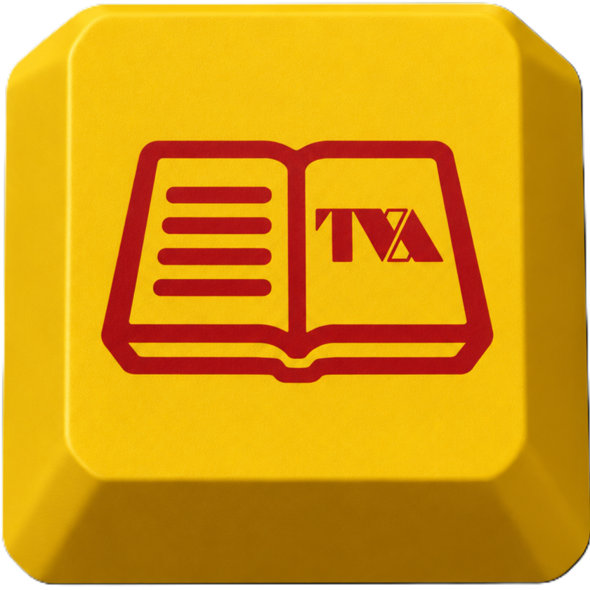

# MischiefOS
## Built for WebOS2 Mission in [Stardance hackclub](https://stardance.hackclub.com/projects/61015)
A Retro - Futuristic themed OS inspired by MARVEL TV SERIES ___"LOKI"___

#### [Visit My Creative Lowki OS](https://mischief-os.vercel.app/)

### MAKE THESE THINGS READY BEFORE VISIT
- Be creative
- Be Excited
- loud the voice
- Put hands on keyboard also

### STEPS TO EXPLORE IN PROPER WAY
1. Click on center button first to boot OS
2. then click anywhere to open actual os desktop
3. read Guide Book to know all things

### Features 
---
1. Read guide to know all features.
1. Boot Screen with booting animationa and sound
2. Lock Screen with Bento Grid Style and lots of widgets
   > Made with details to feel real desktop lock screen
   - time
   - Music Widget
   - images
   - visit counter
   - weather widget
   - qoute widget
   - apps
3. top bar Features: 
   - can be change appearance from setting
   - os name
   - visitor counter
   - weather
   - timer 
   - time display
4. Analog clock Displays time of 3 different time zones Including:
   1. Asia/kolkata
   2. Pacific/Chatham
   3. Pacific/Apia
   - can be hide from setting 
5. Intro 
   - Shows Intro Details about My OS with Inspiration book
   - Link to my Github Repo
6. Journal
   - A real TVA(A organization in Series) Inspired Journal book
   - can add or make and save notes.
   - pagination.
7. Wallpaper can be changed from setting, also can upload custom
8. terminal features various commands, explore by typing "help"
9. music player contains 4 musics with vinyl player.
10. wikipedia shows some inside of tva
11. library is something different, just explore it yourself to be amazed.
12. gallery also contains some very exciting contents.
13. please don't leave without playing mygame. see animations.
14. there are lots of things i made, explore all the os to exprience yourself.

#### What you will experience during review is pure retro futuristc world - an enviroment - a timeline where things gone beyond current technology

---
### This is explicitly for REVIWER:
### - Everything You'll see on the interface is ideat and coded by myself.
### - Used AI just for debugging, after WEbOS 1 I dont used it either.
### - The mistakes and even wrong logic(which also mine) was resolved by me by understanding problem. 
### - Even i mentioned in code where i used ai
--- 
### What my idea for this is:
- Retro Futurism interface that doesn't feel heavy and bold.
- Just a unique art direction that differentiate ongoing Tech Trend.
- So I started Brainstorming and come to conclusion:
> I can't think to go againts the choice of LOKI
